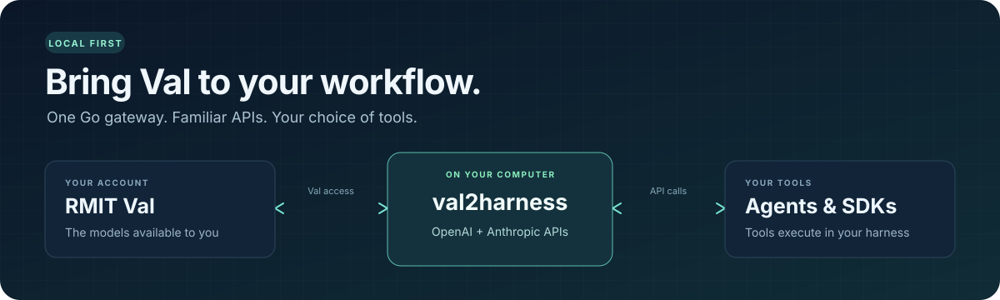

<p align="center">
  
</p>

<h1 align="center">val2harness</h1>

<p align="center"><strong>Use your Val account with the tools you already work in.</strong></p>

<p align="center">
  <a href="go.mod"></a>
  <a href="#compatibility"></a>
  <a href="LICENSE"></a>
</p>

<p align="center">
  <a href="#quick-start">Quick start</a> ·
  <a href="#how-it-works">How it works</a> ·
  <a href="#connect-a-tool">Connect a tool</a> ·
  <a href="#quota-and-usage">Quota &amp; usage</a> ·
  <a href="#compatibility">Compatibility</a> ·
  <a href="#your-data-stays-yours">Your data</a> ·
  <a href="#development">Development</a>
</p>

**val2harness** is a local bridge between your authorized [RMIT Val](https://val.rmit.edu.au)
account and coding agents. It translates familiar API requests, forwards them to
Val, and returns the response. Your chosen harness runs the tools.

- **One executable.** Go gateway, terminal menu, and embedded web dashboard.
- **Two familiar APIs.** OpenAI Chat Completions and an Anthropic Messages adapter.
- **Practical connections.** Configuration writers for OMP, Pi, OpenCode, and Continue.
- **User-owned data.** Local credentials, preserved settings, and private conversation exports.
- **Measured usage.** Observe normal requests without spending quota on background probes.

> [!IMPORTANT]
> This development branch contains fixes newer than the published **v1.0.0** packages.
> Build this branch to use the behavior documented here. Model access and quota
> still depend on your Val account.

## Quick start

### 1. Build the current branch

Install [Go 1.26 or newer](https://go.dev/dl/), then clone this development branch:

```sh
git clone --branch codex/passive-quota-checker https://github.com/mncuchiinhuttt/val2harness.git
cd val2harness
```

**macOS / Linux**

```sh
go build -o val2harness .
./val2harness open
```

**Windows PowerShell**

```powershell
go build -o val2harness.exe .
.\val2harness.exe open
```

The `open` command starts the local gateway if needed and opens an authenticated
dashboard. Prefer the terminal menu? Run the executable without a command and use
the arrow keys and Enter.

### 2. Connect your Val account

Use the dashboard's login and token controls to connect your account. Keep the
Val token on your own computer. The dashboard also shows your local connection
details, available models, and gateway status.

Check the models your account actually provides:

```sh
./val2harness models
```

Examples below use `./val2harness`. On Windows, use `.\val2harness.exe` instead.

### 3. Connect your tool

Run `./val2harness env` to view your private connection settings, then enter the
base URL and **local key** in your tool. The local key is different from your Val
token. See [Connect a tool](#connect-a-tool) for the API settings.

<details>
<summary><strong>Prefer a prebuilt download?</strong></summary>

The [v1.0.0 release](https://github.com/mncuchiinhuttt/val2harness/releases/tag/v1.0.0)
has packages for Windows, Linux, and macOS, including x64 and ARM64 builds, with a
published `checksums.txt`. These older packages do **not** contain this branch's
authentication, configuration-preservation, and agent-compatibility fixes.

The existing [shell installer](install.sh) and [PowerShell installer](install.ps1)
also install release binaries. They do not build this branch or automatically
verify its new behavior. Use the source steps above for this development version.

</details>

## How it works

Your tool sends API requests to the local gateway, which forwards the selected
inputs to Val. Your harness executes returned tool calls with its own permissions.

<p align="center">
  
</p>

## Connect a tool

Default connection settings:

| Client | Base URL | Credential |
| --- | --- | --- |
| OpenAI SDK / Chat Completions client | `http://127.0.0.1:8765/v1` | Your private **local key** |
| Anthropic SDK / Claude Code | `http://127.0.0.1:8765` | Your private **local key** |

Use your configured address if you changed the default port. Choose a model ID
returned by `./val2harness models`; model discovery alone does not prove every
feature works with that model.

### Claude Code

Set `ANTHROPIC_BASE_URL` and `ANTHROPIC_API_KEY` using the local connection details.
Disable extended thinking for this adapter and retain Claude Code's tool permissions.

```sh
export ANTHROPIC_BASE_URL="http://127.0.0.1:8765"
export ANTHROPIC_API_KEY="<your private local key>"
export MAX_THINKING_TOKENS=0

claude --model anthropic-claude-sonnet-4-6 --settings '{"alwaysThinkingEnabled":false}'
```

<details>
<summary>PowerShell environment settings</summary>

```powershell
$env:ANTHROPIC_BASE_URL = 'http://127.0.0.1:8765'
$env:ANTHROPIC_API_KEY = '<your private local key>'
$env:MAX_THINKING_TOKENS = '0'

claude --model anthropic-claude-sonnet-4-6 --settings '{"alwaysThinkingEnabled":false}'
```

</details>

The example model must be available to your account. Signed/adaptive thinking,
native server tools, and token-counting endpoints are outside this adapter's scope.

### OpenAI-compatible clients

Set `OPENAI_BASE_URL` and `OPENAI_API_KEY` in your SDK or tool. For Bash and Zsh,
you can load the gateway's actual private settings directly:

```sh
eval "$(./val2harness env)"
```

The output includes your local key; keep it out of screenshots, issues, and commits.
Clients must support **Chat Completions**. The OpenAI **Responses API** is not implemented.

### OMP, Pi, OpenCode, and Continue

```sh
./val2harness sync
```

Sync writes provider settings for all four adapters. It preserves unrelated
settings and retains the first original as a `.bak` backup. It refuses malformed
files and unsafe states instead of overwriting them. See the
[configuration and recovery notes](docs/CONFIG_AUTH_FIX.md) before restoring settings.

## Quota and usage

The dashboard observes requests you already make through the gateway. Refreshing
the quota view sends no inference request. It distinguishes an observed successful
completion, exhausted budget, temporary rate limiting, expired/rejected credentials,
and provider failures, and shows when the observation was made.

```sh
./val2harness quota
./val2harness quota --json
```

These commands read the running gateway's local cache. Measured input/output
tokens are shown separately from requests whose usage is missing. **Remaining
account quota and reset time stay Unknown**: the inspected Val response does not
provide an authoritative contract for them.

Observations cover this gateway session, excluding the Val website and other
clients. They stay in memory and clear on restart, account-token change, or
**Clear observations**. Prompts, replies and tool arguments are not kept in the
usage tracker. Older `usage.jsonl` files are neither loaded nor deleted automatically.
See [verification and recovery notes](docs/PASSIVE_QUOTA_CHECK.md) for the
28 October local checks and current release limits.

## Compatibility

The following live evidence was recorded on **27 October 2026**. Offline SDK
regressions passed again on **28 October**; no additional live Val calls were made.

| Client / flow | Verified behavior |
| --- | --- |
| Anthropic Python SDK **2.3.0** | Live Sonnet JSON tool/result loops and streaming image-assisted tool use. |
| OpenAI Python SDK **3.38.0** | Live Sonnet streaming image → tool call → tool result → final reply; JSON loops also passed against a fake upstream. |
| Claude Code **2.1.310** | Live Read and Edit execution, exact edited file bytes, returned tool results, and zero permission denials in a disposable fixture. |
| Configuration adapters | OMP, Pi, OpenCode, and Continue preservation/restore checks; this does not establish every harness's runtime behavior. |

The live Edit run met the file-content and tool-turn checks, then failed an overly
strict final-reply formatting check. That checker was corrected and verified
offline; the corrected checker was not rerun live. The full record is in
[OpenAI and editing verification](docs/OPENAI_EDIT_CHECK.md).

<details>
<summary><strong>Protocol limits worth knowing</strong></summary>

- **Messages SSE is buffered** until a complete turn, measured usage, and valid
  tool arguments are available. Chat Completions response streaming stays incremental.
- **Messages validates returned tools.** Undeclared or incomplete calls fail before
  delivery. OpenAI response bytes remain pass-through; the consuming tool owns validation.
- **Request limits:** 32 MiB for shared input and adapted payload; Messages has an
  additional 8 MiB input limit. Oversized requests receive HTTP 413.
- **Upstream features vary.** Some models reject controls or omit usage. Messages
  requires measured usage and does not invent token counts.
- **Effort/cache hints:** supported hint shapes are disclosed as adaptations;
  no native thinking or prompt-caching behavior is promised.
- **Separate APIs:** OpenAI Responses, Files, Batches, and Anthropic token counting
  are not implemented.

See the [full compatibility matrix](docs/AGENT_COMPATIBILITY.md) for content types,
cancellation, tool choice, image limits, and tested failure cases.

</details>

## Your data stays yours

Open-source code does not make your credentials, conversations, settings, or
exports public. Your Val token stays in local configuration and authenticates
requests to your configured Val service. The gateway's local key controls access
to both inference and management, including settings and exports. Treat it as an
owner credential.

Your selected prompts, images, and tool results go to Val for inference. The
service's logging and retention are outside this gateway's control. The harness
executes tools with its own permissions; the gateway does not run model-requested tools.

Exports create private files in a fresh `exports/run-*` directory by default.
Existing export targets are not overwritten. See [export behavior](docs/EXPORT_FIX.md)
for Windows ACLs, Unix permissions, and partial-result recovery.

<details>
<summary>Local access and upgrade notes</summary>

- Default listener: `127.0.0.1:8765`. Keep it local unless you deliberately configure
  and protect another deployment.
- Configuration: `~/.config/val2harness/config.json`. The gateway provisions a random
  local key when one is missing.
- `open` exchanges a short-lived, single-use sign-in link for a tab session.
  Restarting the gateway invalidates those sessions.
- When upgrading from an older static-key build, restart the gateway and resync
  harness settings so they use the current local key.
- Settings/backup privacy on Windows depends on inherited account-directory ACLs;
  explicit export ACLs do not imply every configuration file has the same guarantee.

</details>

## Everyday commands

| Command | Purpose |
| --- | --- |
| `./val2harness` | Open the terminal menu |
| `./val2harness open` | Open an authenticated dashboard |
| `./val2harness start` / `stop` / `status` | Manage the background gateway |
| `./val2harness serve` | Run in the foreground |
| `./val2harness models` | Discover your account's models |
| `./val2harness chat <model-id>` | Chat in the terminal |
| `./val2harness sync` | Write the four supported harness configurations |
| `./val2harness env` | View private client connection settings |
| `./val2harness quota [--json]` | Read observed status and measured gateway-session usage |
| `./val2harness version` | Print the installed version without a network request |
| `./val2harness update --check` | Explicitly check GitHub for a newer release |
| `./val2harness update` | Install a release only after its matching checksum is verified |
| `./val2harness export [directory]` | Export conversations as JSON and Markdown |
| `./val2harness help` | View command help |

After installing an update, restart the gateway to use the new executable.
Active requests stay on the running version until restart.

## Development

The application is a Go executable with embedded web assets. Python and Node.js
are used for optional checks, not required to run the gateway.

```sh
go test ./...
go vet ./...
node --check internal/web/static/app.js
```

Optional SDK/CLI fixtures live in [`tests/`](tests/). They use synthetic data and
temporary directories. Live checks require explicit opt-in and consume Val quota;
ordinary Go tests do not make incidental live calls.

Native Windows and Ubuntu checks passed. macOS builds were checked, but macOS
runtime behavior still needs verification. This branch has not been packaged as
a new release.

### Find your way around

| Area | Read next |
| --- | --- |
| Architecture and code paths | [Project context](docs/PROJECT_CONTEXT.md) |
| Tested clients and protocols | [Compatibility matrix](docs/AGENT_COMPATIBILITY.md) |
| Most recent live checks | [OpenAI / Edit checkpoint](docs/OPENAI_EDIT_CHECK.md) |
| Bugs, fixes, and review scope | [Bug audit](docs/BUG_AUDIT.md) · [Security review summary](docs/SECURITY_REVIEW.md) |
| Configuration and recovery | [Config/auth](docs/CONFIG_AUTH_FIX.md) · [Daemon](docs/DAEMON_FIX.md) · [Exports](docs/EXPORT_FIX.md) |
| Contributor workflow | [AGENTS.md](AGENTS.md) · [Development workflow](docs/DEVELOPMENT_WORKFLOW.md) |

Contributions are welcome. Keep changes focused, include meaningful regression
evidence, and describe the client/model/version actually tested. Use synthetic
fixtures and redact diagnostics before sharing an issue.

## License

[MIT](LICENSE) © 2026 mncuchiinhuttt.
