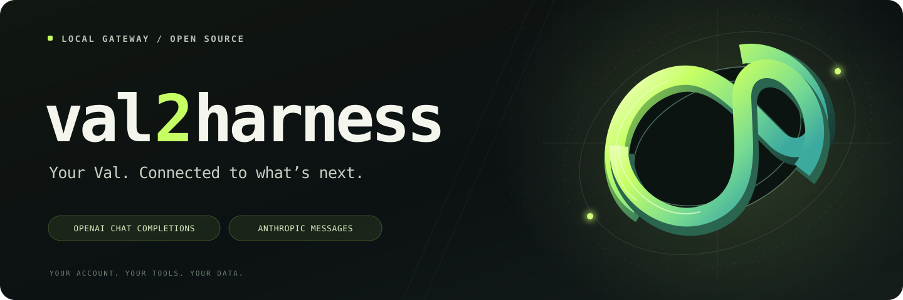
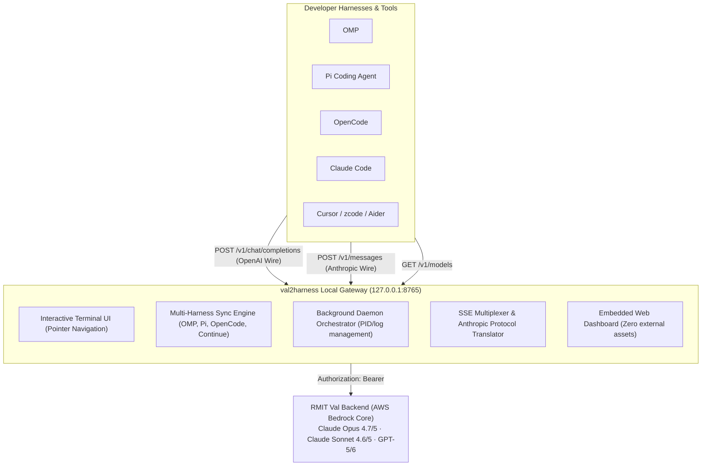

<p align="center">
  
</p>

# val2harness

**High-Performance AI Bridge Connecting RMIT Val to Agent Harnesses**

[](https://golang.org)
[]()
[]()
[](LICENSE)

**val2harness** bridges institutional access on **RMIT Val AI** (`https://val.rmit.edu.au`) directly into developer agent harnesses, including **OMP**, **Pi Harness**, **OpenCode**, **Claude Code**, **Continue**, **Cursor**, and **zcode**.

Engineered in Go as a single static binary (<10MB, <15MB RAM), it exposes dual native wire-format gateways: **OpenAI-compatible Chat Completions** and **Anthropic-compatible Messages API** with real-time Server-Sent Events (SSE) streaming.

---

## Downloads

Precompiled static binaries for version **v1.0.0**:

| Platform | Architecture | Package |
| :--- | :--- | :--- |
| **macOS** | Apple Silicon (M1/M2/M3/M4) | [val2harness-darwin-arm64.tar.gz](https://github.com/mncuchiinhuttt/val2harness/releases/download/v1.0.0/val2harness-darwin-arm64.tar.gz) |
| **macOS** | Intel (x86_64) | [val2harness-darwin-amd64.tar.gz](https://github.com/mncuchiinhuttt/val2harness/releases/download/v1.0.0/val2harness-darwin-amd64.tar.gz) |
| **Linux** | x86_64 | [val2harness-linux-amd64.tar.gz](https://github.com/mncuchiinhuttt/val2harness/releases/download/v1.0.0/val2harness-linux-amd64.tar.gz) |
| **Linux** | ARM64 / aarch64 | [val2harness-linux-arm64.tar.gz](https://github.com/mncuchiinhuttt/val2harness/releases/download/v1.0.0/val2harness-linux-arm64.tar.gz) |
| **Windows** | x64 (64-bit) | [val2harness-windows-amd64.zip](https://github.com/mncuchiinhuttt/val2harness/releases/download/v1.0.0/val2harness-windows-amd64.zip) |
| **Windows** | ARM64 | [val2harness-windows-arm64.zip](https://github.com/mncuchiinhuttt/val2harness/releases/download/v1.0.0/val2harness-windows-arm64.zip) |

All packages are verified via [checksums.txt](https://github.com/mncuchiinhuttt/val2harness/releases/download/v1.0.0/checksums.txt).

### Quick Installation

**macOS / Linux:**
```bash
curl -fsSL https://raw.githubusercontent.com/mncuchiinhuttt/val2harness/main/install.sh | bash
```

**Windows (PowerShell):**
```powershell
irm https://raw.githubusercontent.com/mncuchiinhuttt/val2harness/main/install.ps1 | iex
```

---

## System Architecture



---

## Interactive Terminal UI

Run `val2harness` without arguments to launch the interactive TUI. Use keyboard arrow keys (`↑` / `↓`) and `Enter` to navigate:

```text
val2harness · RMIT Val AI Bridge
Status: ● Running (PID 4874) · Port: 127.0.0.1:8765
────────────────────────────────────────────────────────────

❯ Start Server (Background Daemon)
  Stop Server
  Check Server Status & Health
  Open Web Dashboard in Browser
  Quick Chat in Terminal (Test Opus 4.7/5)
  Sync Models to ALL Harnesses (OMP, Pi, OpenCode, Continue)
  Show Shell Environment Variables (Claude Code, Cursor, zcode)
  View Available Models
  Change Listen Port
  Update RMIT Val Token
  Export Chat History to Markdown
  Exit

Use ↑/↓ to navigate · Enter to select · Esc/q to exit
```

---

## Supported Models

RMIT Val exposes 53 institutional models. Key flagship models available through `val2harness`:

- `anthropic-claude-opus-4-7`: Anthropic premier multimodal reasoning model
- `anthropic-claude-opus-5`: Latest Anthropic flagship foundation model
- `anthropic-claude-sonnet-4-6`: High-efficiency agent coding model
- `anthropic-claude-sonnet-5`: Next-generation reasoning and synthesis model
- `anthropic-claude-haiku-4-5`: High-speed compact model
- `openai-gpt-5` / `openai-gpt-5.1` / `openai-gpt-5.2` / `openai-gpt-5.4`
- `openai-gpt-5.6-luna` / `openai-gpt-5.6-terra`
- `openai-gpt-6-luna` / `openai-gpt-6-sol`
- `meta-llama-4-maverick` / `meta-llama-4-scout`

---

## Harness Integrations

### 1. Multi-Harness Auto-Sync

Sync all detected agent harnesses in one step:

```bash
val2harness sync
```

This writes provider configuration blocks directly into:
- **OMP**: `~/.omp/models.yml` (53 models)
- **Pi Harness**: `~/.pi/models.json` (53 models)
- **OpenCode**: `~/.config/opencode/opencode.json` (53 models)
- **Continue**: `~/.continue/config.yaml` (flagship models)

### 2. Claude Code CLI

Claude Code communicates over the Anthropic Messages API (`/v1/messages`). `val2harness` translates requests and streams native Anthropic SSE events:

```bash
export ANTHROPIC_BASE_URL="http://127.0.0.1:8765"
export ANTHROPIC_API_KEY="rmit-val-key"

claude
```

### 3. Cursor, zcode, Aider & OpenAI SDKs

Export universal OpenAI variables:

```bash
eval $(val2harness env)
```

Generated variables:
```bash
export OPENAI_BASE_URL="http://127.0.0.1:8765/v1"
export OPENAI_API_KEY="rmit-val-key"
export ANTHROPIC_BASE_URL="http://127.0.0.1:8765"
export ANTHROPIC_API_KEY="rmit-val-key"
```

---

## CLI Command Reference

```bash
# Daemon Management
val2harness start          # Launch background server on 127.0.0.1:8765
val2harness stop           # Terminate running background server
val2harness status         # Check PID, listen address, and health
val2harness serve          # Run server in foreground (supports -addr and -upstream)

# Interaction & Chat
val2harness                # Launch interactive TUI
val2harness chat           # Start streaming chat in terminal (Claude Opus 4.7)
val2harness chat <model>   # e.g., val2harness chat anthropic-claude-opus-5
val2harness open           # Open Web Dashboard in default browser

# Sync & Configuration
val2harness sync           # Sync models to OMP, Pi, OpenCode, and Continue
val2harness env            # Print shell export commands
val2harness models         # List all 53 available models
val2harness token <jwt>    # Set RMIT Val Bearer JWT token
val2harness export         # Export conversation history to ./exports/*.md
```

---

## Building From Source

Prerequisites: Go 1.24+

```bash
git clone https://github.com/mncuchiinhuttt/val2harness.git
cd val2harness
go build -ldflags="-s -w" -o val2harness .
./val2harness
```

---

## License

This project is licensed under the [MIT License](LICENSE).

```text
MIT License

Copyright (c) 2026 mncuchiinhuttt

Permission is hereby granted, free of charge, to any person obtaining a copy
of this software and associated documentation files (the "Software"), to deal
in the Software without restriction, including without limitation the rights
to use, copy, modify, merge, publish, distribute, sublicense, and/or sell
copies of the Software, and to permit persons to whom the Software is
furnished to do so, subject to the following conditions:

The above copyright notice and this permission notice shall be included in all
copies or substantial portions of the Software.

THE SOFTWARE IS PROVIDED "AS IS", WITHOUT WARRANTY OF ANY KIND, EXPRESS OR
IMPLIED, INCLUDING BUT NOT LIMITED TO THE WARRANTIES OF MERCHANTABILITY,
FITNESS FOR A PARTICULAR PURPOSE AND NONINFRINGEMENT. IN NO EVENT SHALL THE
AUTHORS OR COPYRIGHT HOLDERS BE LIABLE FOR ANY CLAIM, DAMAGES OR OTHER
LIABILITY, WHETHER IN AN ACTION OF CONTRACT, TORT OR OTHERWISE, ARISING FROM,
OUT OF OR IN CONNECTION WITH THE SOFTWARE OR THE USE OR OTHER DEALINGS IN THE
SOFTWARE.
```
