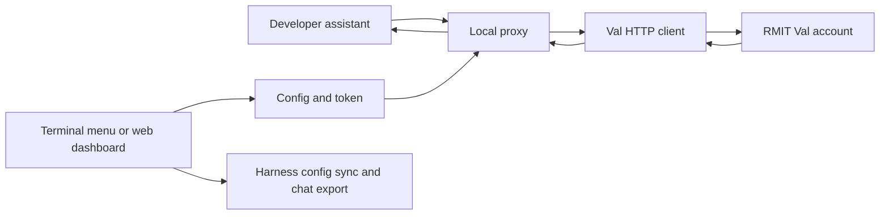

# val2harness project context

Inspected on 26 October 2026 at upstream commit
`6999a37c298137e386567dfabee38d8c9caf83d0` on `main`.
Repository: <https://github.com/mncuchiinhuttt/val2harness>.

Development direction: see `../AGENTS.md` and `DEVELOPMENT_WORKFLOW.md` for the
bug-first workflow, required tools, and subsequent usability/interoperability
research. The observations below are the initial inspection baseline; the later
reproductions and security results are recorded in `BUG_AUDIT.md`.

Current branch: `codex/passive-quota-checker`, created on 28 October 2026 from
published `codex/agent-compatibility-readme` at `bf9ad72`. Main `d8e4760` is now
integrated while retaining the verified fixes. Source checkpoint `60907a5` adds
passive session observations, protected dashboard/CLI views, narrow port/token
persistence and a bounded checksum-required updater. See
[PASSIVE_QUOTA_CHECK.md](PASSIVE_QUOTA_CHECK.md) for current checks, recovery and
review limits. Main is not a push/merge destination. The earlier
[publication plan](superpowers/plans/2026-10-27-readme-publish.md) is historical;
local tools and raw diagnostics remain excluded.

Historical debugging state: branch `codex/preserve-config-owner-auth` based on the
same commit, with uncommitted configuration-preservation and owner-authentication
fixes plus runtime/protocol, agent tools/images, daemon and export corrections.
Read [AGENT_COMPATIBILITY.md](AGENT_COMPATIBILITY.md) for the current tested
matrix, [DAEMON_FIX.md](DAEMON_FIX.md) and [EXPORT_FIX.md](EXPORT_FIX.md) for those
subsystems, and [CONFIG_AUTH_FIX.md](CONFIG_AUTH_FIX.md) / [RUNTIME_FIX.md](RUNTIME_FIX.md)
for earlier checkpoints. Anthropic SDK 2.3.0 and Claude Code 2.1.310 passed isolated
tool loops against a fake upstream. Subsequent live checks passed Sonnet JSON
tool/result loops and an automatic streaming image-assisted tool/result loop.
See [SONNET_FIX.md](SONNET_FIX.md) for current causes, Claude Code verification,
quota, security scope and limits, and [LIVE_VAL_CHECK.md](LIVE_VAL_CHECK.md) for
earlier observations. Counts and candidate issues in the initial
inspection sections below describe the upstream baseline.

Latest, 27 October: [OPENAI_EDIT_CHECK.md](OPENAI_EDIT_CHECK.md) records shared
Val client registration for both protocols, the 32 MiB input/adapted request cap,
preserved retry delays and no automatic 307/308 POST replay. Official OpenAI SDK
3.38.0 passed a live streaming image/tool/result loop. Claude Code live editing
verified exact file bytes, three turns and zero permission denials; its final
reply-format assertion was corrected offline. All 32 historical attempts are
used; one previously unused attempt was retired. No user daemon was replaced.

Earlier on 28 October: `codex/rea-quota-research` started from published `bf9ad72`.
[REA_QUOTA_RESEARCH.md](REA_QUOTA_RESEARCH.md) records the optional local REA
6.8.0 CLI/skill installation, public Val artifact analysis, synthetic capture
verification and four reproduced false-availability cases in remote main's
quota checker. No application source or running gateway was changed. After a
user-authorized token refresh, one read-only self-account request returned HTTP
200 but no quota contract. No new inference was sent. Exact account quota and
reset policy remain unverified; private response values remain local.

Later on 28 October, that research was carried into the current feature branch.
The passive checker is now implemented and locally verified; it keeps remaining
quota/reset unknown. This supersedes the research-only implementation status.
Read PASSIVE_QUOTA_CHECK.md before relying on older handoff text below.
The current offline Graphify refresh contains **1,025 nodes, 3,415 edges and 66
communities**. External AI and query logging are disabled; documentation semantic
extraction was not rerun and missing Go receiver edges remain inconclusive.

## Purpose

A local Go gateway that lets developer tools use an existing RMIT Val account.
The gateway accepts OpenAI Chat Completions or a subset of Anthropic Messages,
authenticates upstream requests with the account's Val bearer token, and streams
the response back. It does not host or train models. Model availability depends
on the upstream account; the README's model names and count were not verified
against a live account.

The checkout contains 37 tracked files, including 25 Go source files (about 2,174
nonblank lines). It is one executable, with an embedded HTML/CSS/JavaScript
dashboard, a terminal menu, configuration writers, and background process
management. There is no application database or frontend package/build system.
Dependencies are primarily the Go standard library, plus YAML and terminal APIs.
The application is MIT licensed.

User data belongs to the user. Public source code does not make tokens,
conversations, settings, diagnostics, or exports public. Additional collection or
sharing needs explicit consent; intended model requests use the configured Val
service. Audit tests used synthetic data and isolated configuration only.

## Main code paths

| Area | Entry points and responsibility |
| --- | --- |
| CLI | `main.go` dispatches commands; `commands.go` implements management, sync, token, models, and export commands. No arguments enters `tui.RunTUI`. |
| Startup | `serve.go:runServe` loads configuration, creates `valclient.Client` and `proxy.Server`, registers web routes, and handles shutdown. |
| Local HTTP | `internal/proxy/server.go` registers routes; `auth.go` enforces owner credentials, Host/Origin checks, and scoped tickets across inference/management aliases. Default address: `127.0.0.1:8765`. |
| OpenAI forwarding | `internal/proxy/completions.go:handleChatCompletions` passes the request body to `Client.ProxyChat`, preserves upstream HTTP status, and flushes streamed bytes. |
| Anthropic adaptation | `messages.go` checks HTTP status; `messages_request.go` maps tools/controls; `messages_content.go` validates text/images and paired tool history; `messages_tools.go` validates calls/choice; `messages_contract.go` translates JSON/real usage; `messages_stream.go` buffers bounded SSE until complete validated output and measured usage. Exact model aliases only; unknown IDs pass upstream. |
| Upstream client | `internal/valclient/client.go` owns synchronized live credentials and takes one token snapshot per HTTP request. It accepts wrapped/raw empty model arrays. |
| SSE framing | `internal/sse/decoder.go` handles bounded LF/CRLF/CR, multiline data, no-space fields, and incomplete events for both Messages and terminal chat. |
| Settings | `internal/config/config.go` provisions a persisted random local key before applying environment overrides. `internal/configfile/` provides serialized, validated, private atomic updates and first-original backups. |
| Dashboard | `internal/web/handler.go` embeds static assets and handles token/login/status routes. `api_routes.go` handles sync, restore, environment snippets, and export. |
| Harness configuration | `internal/sync/` writes OMP, Pi, OpenCode, and Continue files. OMP serialization lives in `internal/omp/sync.go`. |
| Background process | `internal/daemon/` serializes lifecycle operations, verifies process identity, starts hidden on Windows, and uses a scoped random capability for child readiness/graceful stop. Unverifiable Unix termination is refused. |
| Export | `internal/exporter/` pins the output root, creates private exclusive JSON/Markdown, retains precise source numbers and reports partial outcomes. Default callers choose fresh private `exports/run-*` folders; Windows uses an explicit protected DACL. |



An OpenAI chat request follows `Server.ServeHTTP` -> the mux ->
`handleChatCompletions` -> `Client.ProxyChat` -> Val's
`/api/chat/completions`. The outgoing authorization is the saved Val token,
not the private connection key used by local clients. The gateway forwards
response bytes and flushes them so text appears as it arrives.

## Verified baseline and limits

- `go test ./...` passed on Windows with Go 1.26.0. All ten packages report
  `[no test files]`: this establishes compilation, not behavioral coverage.
- `go vet ./...` passed.
- `node --check internal/web/static/app.js` passed.
- `go build -ldflags '-s -w' -o val2harness.exe .` passed. The local Windows
  executable is 7,960,576 bytes (about 7.6 MiB) and is ignored by Git.
- `go.mod` requires Go 1.26.0, despite the README saying 1.24+. The existing
  system Go is 1.23.4; Go automatically fetched the required 1.26.0 toolchain
  during verification.
- No application server was started and no Val token, upstream requests, model
  availability, live streaming, or third-party harness integration was tested.
- Harness sync was inspected but not executed; it would modify files in the
  user's home directory and attempt `.bak` backups.

## Implementation findings to resolve before relying on it

These are source observations, not a completed security or compatibility audit.

1. **Anthropic compatibility is partial.** `anthropicReq` has no tools or tool
   choice fields, and `extractText` retains only text content blocks. Images,
   `tool_use`, and `tool_result` blocks are discarded. `max_tokens` is parsed but
   not forwarded. Token counts are placeholders. A text chat demo does not prove
   Claude Code can perform its tool-driven coding workflow.
2. **Anthropic upstream errors are not preserved.** The adapter does not check
   `upstreamResp.StatusCode` before generating a normal response or SSE stream.
   It ignores several parsing/stream errors and can produce an empty success.
3. **Authentication is local and optional.** The default API key is empty and
   CORS permits every origin. The same mux serves management routes that can
   update tokens, sync configurations, and export chats. Review that boundary
   before broader exposure. The generated shell snippet always uses the
   placeholder key even when a custom local API key is configured.
4. **Concurrent token updates need review.** `Server.UpdateToken` has a lock,
   but `Client.SetToken`/`GetToken` and normal client operations access the same
   token without that lock. No race test exists.
5. **Sync and export have weak failure handling.** Several writers ignore
   backup/parse/write errors. `SyncAll` runs all four adapters rather than
   checking which applications are installed. Export ignores individual write
   failures and slices the first eight characters of chat IDs without checking
   length. Continue's deduplication assumes port 8765.
6. **Documentation promises need evidence.** Model counts, model identities,
   context limits, memory/performance claims, and external client compatibility
   are not established by this inspection. Installer scripts do not verify the
   downloaded binary against checksums, despite checksum files being advertised.

## Graphify setup

Graphify **0.9.95** (`graphifyy`, with two y's on PyPI) is installed using
`uv tool install`, in an isolated environment outside the application. The CLI
is on PATH as `graphify`. Project integration is under `.codex/skills/graphify/`
and `AGENTS.md`; no global Codex configuration, MCP server, or Git hooks were
installed. The official installer generated a documented no-op PreToolUse hook;
that unnecessary new hook file was removed.

Graphify was chosen because its local parsers cover this Go/JavaScript project,
it supports Windows, and its Apache-2.0 license avoids GitNexus's current
PolyForm Noncommercial licensing restriction. Source:
[Graphify](https://github.com/Graphify-Labs/graphify),
[Graphify license](https://github.com/Graphify-Labs/graphify/blob/v8/LICENSE),
[GitNexus license](https://github.com/abhigyanpatwari/GitNexus#license).

Use these commands from the repository root in PowerShell:

```powershell
# Initial setup on another machine; requires Python 3.10+ and uv.
uv tool install 'graphifyy==0.9.95'

# Apply to this shell/process only. Disable external AI backends and query logs.
$env:GRAPHIFY_BACKEND = 'none'
$env:GRAPHIFY_QUERY_LOG_DISABLE = '1'

# First build. Code-only parsing does not send source to an AI provider.
graphify extract . --code-only --max-workers 2
graphify cluster-only . --no-label

# Focused navigation examples.
graphify query 'handleChatCompletions ProxyChat' --budget 1500
graphify explain handleMessages
graphify path handleMessages extractText
graphify explain SyncAll

# After source changes or pulling new commits.
graphify update .
graphify cluster-only . --no-label
```

The first code-only build scanned 29 code-classified files, yielding 160 nodes,
461 edges, and 15 communities. A subsequent local `update` also extracted Markdown
structure and source references from README, AGENTS, and this guide, yielding
**185 nodes, 500 edges, and 12 communities**. Both ran with external AI disabled;
the report records zero LLM input/output tokens. All 25 Go source files are
represented. CSS and Makefile were not classified as supported inputs. `go.mod`
and `install.ps1` produced no symbols. `.graphifyignore` excludes generated
artifacts, exports, distribution files, and assistant integration files.

Outputs (ignored, reproducible local files):

- `graphify-out/graph.json`: queryable graph with source locations.
- `graphify-out/GRAPH_REPORT.md`: generated structural overview.
- `graphify-out/graph.html`: interactive visualization. Its renderer loads
  vis-network JavaScript from unpkg.com; displaying it needs network access.

**Coverage caveat:** the graph locates `handleMessages` -> `extractText`, but it
does not connect `handleChatCompletions` -> `Client.ProxyChat`, even though the
call is plainly present in source. Stored graph metadata is undirected and path
queries default to directed searches. Treat paths and missing edges as navigation
assistance, and verify execution order and dependencies in source. Community
labels come from deterministic structural heuristics; AI labeling is disabled.

After the configuration/authentication increment, the local graph was refreshed
with external AI and query logging disabled: **369 nodes, 1,079 edges, and 18
communities**. This includes the new Go implementation/tests. The code updater
reported no symbols for `go.mod`, `install.ps1`, and the Playwright function file;
five unsupported metadata/style files were skipped. Documentation summaries can
lag the code-only refresh; current source and the fix record take precedence.

After the runtime reliability continuation, the current code graph contains
**443 nodes, 1,361 edges, and 23 communities**, refreshed with the same offline
settings. Coverage caveats above still apply; this is structural context rather
than proof of correct runtime behavior.

After the agent/lifecycle/export continuation, the refreshed code graph contains
**631 nodes, 2,090 edges, and 26 communities**. Update and clustering ran with
external AI and query logging disabled. Documentation semantic extraction was
not rerun; source and the maintained checkpoint documents remain authoritative.

The live-check recorder continuation refreshed the graph offline to **669 nodes,
2,152 edges and 34 communities**, including its Python helpers and regression
tests. No external AI backend or query logging was enabled.
After the live follow-up's clearer tool denial and recorder route/mode tests,
the offline graph contains **674 nodes, 2,166 edges and 26 communities**.

## Next useful increment

The first audit is retained in `BUG_AUDIT.md`; the accepted configuration and
authentication increment is implemented with repository regression tests and a
browser acceptance check. See `CONFIG_AUTH_FIX.md` for exact verification and
limits. The original security scan remains sealed against its original snapshot.

The current continuation implements client tools/results and image translation,
strict measured usage and buffered Messages streams. Windows and Ubuntu normal
package tests and actual CLI lifecycle checks passed; Windows race/vet, official
SDK loops and Claude Code Read/Write acceptance also passed. Exports now retain
private files and accurate partial outcomes. Full evidence is in
AGENT_COMPATIBILITY.md. The native Codex Security diff scan could not start:
its helper selects an ancestor `C:\.git`, then rejects the installed Git binary;
the original sealed audit is unchanged. Focused source reviews and regressions
do not replace a completed final scan.

The later [Sonnet checkpoint](SONNET_FIX.md) supersedes the blocked-tool and
scan status above: a scoped native Standard security scan completed for the
16 proxy files before the latest fixes, followed by independent static patch
review. Client schemas now survive Val's native registry; empty SSE tails retain
late measured usage. The raw OpenAI pass-through does not yet register client
schemas in that Val-specific channel at that checkpoint. The 27 October
continuation now resolves shared OpenAI registration; macOS runtime validation
and broader harness/model coverage remain open.
The final two-attempt Claude Code Read loop has now passed live; all 23 approved
attempts were used at that checkpoint. Its offline graph had 703 nodes,
2,225 edges and 34 communities. Current 27 October refresh/clustering:
**799 nodes, 2,513 edges, 40 communities**. Go receiver-call coverage remains
incomplete; the current total is 32 historical live attempts, none authorized
remaining. The immutable incremental Security assessment recommends human review
before merging; see OPENAI_EDIT_CHECK.md for its exact scope and artifacts.
Initial-audit work still includes installer integrity, the playground stream
parser and three unwired dashboard controls. Non-programmer feature research has
not started; use Firecrawl for current official evidence when that phase begins.
No release readiness or universal harness compatibility is established.
